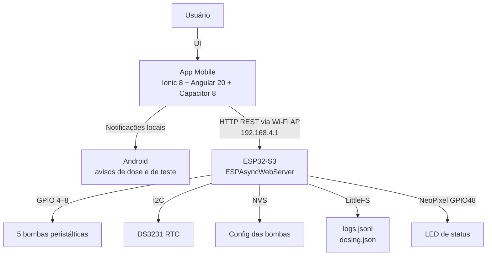

# AquaBalancePro

Sistema de automação de dosagem para aquários marinhos (Reef). Composto por um **aplicativo mobile** para controle,
monitoramento e ajuste das doses, e um **firmware embarcado** em ESP32-S3 que comanda 5 bombas peristálticas e
funciona 100% offline.

## Arquitetura



| Componente | Tecnologia | Função |
|---|---|---|
| **App Mobile** | Ionic 8 + Angular 20 + Tailwind CSS 4 + Capacitor 8 | Configuração, calibração, Ajuste de Dosagem, logs, gráficos e notificações |
| **Firmware** | PlatformIO / Arduino (ESP32-S3, `espressif32@6.9.0`) | Scheduler, fila de bombas, servidor REST, logs |
| **RTC** | DS3231 (I2C) | Mantém a hora para os horários mesmo sem Wi-Fi/internet |
| **Bombas** | 5 peristálticas (GPIO 4, 5, 6, 7, 8) | Dosagem por tempo: `ml × 700 ms × calibrCoef`, uma bomba por vez |
| **Comunicação** | HTTP REST (JSON) via Wi-Fi AP | O celular entra no AP `AquaBalancePro` e fala com `192.168.4.1` |

**Onde ficam os dados:** tudo que importa mora no ESP32, para celular e PC verem o mesmo:
config das bombas na NVS, histórico de doses em `/logs.jsonl` e aquário, produtos e testes do Ajuste de Dosagem em
`/dosing.json` (o firmware só guarda esse JSON; o schema é do app). O celular guarda só preferências (cores das
bombas) e agenda as notificações sozinho a partir da agenda das bombas.

## Funcionalidades

| Tela | O que faz |
|---|---|
| **Home** | Status do ESP32 e do relógio, avisos (teste vencido, estoque, relógio, doses sem registro), resumo de hoje com próxima dose |
| **Configuração** | 5 bombas × 3 horários (dose em passos de 0,5 ml, dias da semana), tipo e produto, estoque, horário automático e avisos ao vivo (KH↔Ca próximos, dose concentrada) |
| **Calibração** | Calibração guiada da vazão com conferência, dose manual e **Ligar até eu desligar** (para escorvar mangueiras) |
| **Ajuste de Dosagem** | Ciclo de testes: mede KH/Ca/Mg, mede de novo após N dias e o app calcula e reparte a nova dose diária |
| **Produtos** | Volume e alvos do aquário, fotoperíodo, produto de cada bomba (catálogo com ~80 suplementos, pós de Balling por g/L) |
| **Logs** | Histórico por dia, doses não executadas, filtros e exportação CSV |
| **Analytics** | Timeline do dia, ml por dia (7/30 dias), previsão de estoque e evolução de KH/Ca/Mg |

## Repositório

```
/
├── src/app/
│   ├── home/ configuracao/ calibracao/ ajuste/ produtos/ logs/ analytics/   # Páginas (standalone, lazy)
│   └── services/           # DoserService (API), regras e cálculos puros com specs, notificações
├── esp32/
│   ├── platformio.ini      # Plataforma fixada em espressif32@6.9.0
│   └── src/main.cpp        # Firmware monolítico (~1670 linhas)
├── android/                # Projeto Android (Capacitor) + plugin nativo WifiBinding
├── ios/                    # Projeto iOS (Capacitor)
├── scripts/phone-debug.mjs # Depuração do app no celular via USB (npm run debug:phone)
├── docs/                   # Documentação detalhada
└── assets/                 # Imagens e logos
```

## API REST (ESP32 → App)

O ESP32 expõe um servidor HTTP na porta `80` no IP `192.168.4.1`. Os `POST` mandam JSON como `text/plain`.

| Método | Endpoint | Descrição |
|---|---|---|
| `GET` | `/ping` | Health check |
| `GET` | `/status` | Hora, Wi-Fi, AP e acionamento contínuo em andamento (`run`) |
| `GET` | `/config` | Configuração atual das 5 bombas |
| `POST` | `/config` | Atualizar configuração das bombas |
| `POST` | `/time` | Sincronizar RTC com o celular |
| `POST` | `/dose` | Dosagem manual imediata (entra na fila) |
| `POST` | `/run` | Liga a bomba até desligar (com sinal do app a cada 1 s; para sozinha em 4 s sem sinal ou 2 min) |
| `GET` | `/logs` | Histórico de dosagens |
| `DELETE` | `/logs` | Limpar histórico |
| `GET` | `/dosing` | Produtos, aquário e histórico do Ajuste de Dosagem (`{}` se vazio) |
| `POST` | `/dosing` | Salva os dados do Ajuste de Dosagem (JSON até 16 KB) |

## Fluxo de Uso

1. **Conectar** — Celular entra no Wi-Fi `AquaBalancePro` (AP do ESP32); o app força o tráfego pelo Wi-Fi
2. **Sincronizar** — A Home compara o relógio do ESP32 com o do celular e oferece sincronizar
3. **Cadastrar** — Em Produtos, volume do aquário, alvos e o produto de cada bomba
4. **Calibrar** — Dose de teste, informa o volume medido, o app recalcula o coeficiente e confere
5. **Configurar** — Horários e doses (ou horário automático); salvar reagenda as notificações
6. **Ajustar** — A cada ciclo de testes, o Ajuste de Dosagem propõe as novas doses; Aplicar grava no ESP32
7. **Monitorar** — Home, Logs e Analytics mostram o que foi dosado e o que ficou sem registro

## Primeiros Passos

### App (Ionic)
```bash
npm install
npm start                      # Desenvolvimento web (ng serve, porta 4200)
npm test                       # Testes unitários (Karma + Jasmine)
npx ng build && npx cap sync android
```

### Android (APK de debug)
```bash
cd android && ./gradlew assembleDebug        # JDK 21, Android SDK 36
adb install -r app/build/outputs/apk/debug/app-debug.apk
npm run debug:phone                          # console, erros e requisições do app no celular
```

### Firmware (ESP32)
```bash
cd esp32
pio run --target upload        # Compilar e enviar via USB
pio device monitor             # Serial monitor (115200 baud)
```

### Hardware (ESP32-S3)

| GPIO | Conexão |
|---|---|
| 4 | Bomba 1 |
| 5 | Bomba 2 |
| 6 | Bomba 3 |
| 7 | Bomba 4 |
| 8 | Bomba 5 |
| 21 (SDA) | DS3231 RTC |
| 20 (SCL) | DS3231 RTC |
| 48 | NeoPixel WS2812B |

## Documentação Detalhada

- [Arquitetura do Sistema](docs/arquitetura.md)
- [App Mobile (Ionic/Angular)](docs/ionic-app.md)
- [Firmware ESP32](docs/esp32-firmware.md)
- [Robustez Offline](esp32/ROBUSTEZ_OFFLINE.md)

## Stack

| Categoria | Tecnologia |
|---|---|
| **Frontend** | Ionic 8, Angular 20 (standalone), Tailwind CSS v4, Chart.js 4, RxJS 7.8 |
| **Mobile** | Capacitor 8 (Android + iOS): local-notifications, filesystem, share, plugin nativo WifiBinding |
| **Firmware** | PlatformIO, Arduino core 2.0.17 (`espressif32@6.9.0`), ESP32-S3 |
| **Bibliotecas** | ESPAsyncWebServer, AsyncTCP-esphome, RTClib, ArduinoJson 7, Adafruit NeoPixel |
| **Persistência** | NVS Preferences (config), LittleFS (logs e Ajuste de Dosagem) |
| **Testes** | Jasmine 5 + Karma 6 (cálculos, regras, catálogo, resumo do dia e logs) |
