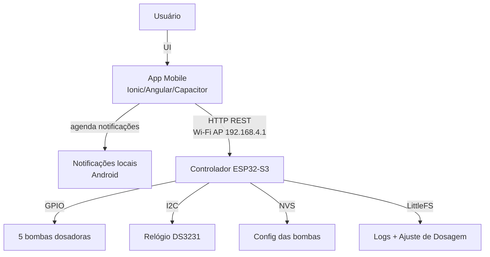

# Arquitetura do Sistema AquaBalancePro

Este documento descreve a arquitetura técnica do sistema **AquaBalancePro**, composto por um aplicativo móvel e um controlador de hardware baseado em ESP32.

## Visão Geral

O sistema automatiza a dosagem em aquários marinhos (Reef): o ESP32 executa a agenda das bombas sozinho, sem
depender de internet, e o app serve para configurar, calibrar, ajustar as doses pelos testes de água e acompanhar
o que foi dosado.

## Componentes

### 1. Aplicativo Móvel (Frontend)

- **Framework**: Ionic 8 + Angular 20 (standalone components, 7 rotas lazy)
- **Nativo**: Capacitor 8; plugin próprio `WifiBinding` no Android
- **Estilo**: Tailwind CSS 4 + componentes Ionic, tema escuro "ocean"
- **Camadas**:
  - **Páginas** (`home`, `configuracao`, `calibracao`, `ajuste`, `produtos`, `logs`, `analytics`): estado local,
    recarregam do ESP32 ao entrar.
  - **`DoserService`**: única porta para o ESP32. Cada requisição faz o bind do processo ao Wi-Fi (o AP não tem
    internet e o Android mandaria o tráfego pelos dados móveis) e tem timeout de 10 s.
  - **Funções puras com testes**: `dosing-advisor` (cálculo do ajuste), `dosing-rules` (sugestões),
    `auto-schedule` (horário automático), `product-catalog`, `dose-check`, `today-summary`, `log-analytics`.
  - **`DoseNotificationsService`**: agenda no próprio celular uma notificação por horário ativo e o lembrete de
    fim de teste, porque o celular quase nunca está na rede do ESP32.

### 2. Firmware (Backend Embarcado)

- **Microcontrolador**: ESP32-S3
- **Framework**: PlatformIO / Arduino core 2.0.17 (`espressif32@6.9.0`)
- **Funcionalidades**:
  - **Servidor Web Assíncrono**: `ESPAsyncWebServer`. Os handlers rodam na task do AsyncTCP, então só registram
    pedidos; quem liga e desliga as bombas é o `loop()`.
  - **Scheduler**: confere os horários uma vez por minuto pelo RTC e enfileira as doses.
  - **Fila de bombas**: buffer circular de 17 jobs protegido por `portMUX`; uma bomba por vez.
  - **Acionamento contínuo** (`/run`): liga até o app desligar, com keepalive de 4 s e limite de 2 min.
  - **RTC DS3231**: mantém a hora sem internet (NTP só quando há Wi-Fi externo).
  - **Persistência**: NVS para a config das bombas; LittleFS para `/logs.jsonl` (até 2000 doses) e
    `/dosing.json` (até 16 KB, gravado de forma atômica).
  - **Wi-Fi**: AP sempre ativo; STA opcional, pausado enquanto há cliente no AP.

## Protocolo de Comunicação (API)

O ESP32 expõe uma API REST na porta 80. Os corpos `POST` são JSON enviados como `text/plain` (evita preflight CORS).

| Método   | Endpoint  | Descrição                                       | Corpo (JSON)                                         |
| -------- | --------- | ----------------------------------------------- | ---------------------------------------------------- |
| `GET`    | `/ping`   | Health check.                                   | -                                                    |
| `GET`    | `/status` | Hora, Wi-Fi, AP e `run` (bomba ligada direto).  | -                                                    |
| `GET`    | `/config` | Configuração atual das bombas.                  | -                                                    |
| `POST`   | `/config` | Atualiza as bombas.                             | `{ "bomb1": { "name", "calibrCoef", "quantidadeEstoque", "schedules": [...] }, ... }` |
| `POST`   | `/dose`   | Dosagem manual imediata (entra na fila).        | `{ "bomb": 1, "dosagem": 10.5, "origem": "Manual" }` |
| `POST`   | `/run`    | Liga/mantém/desliga uma bomba sem volume fixo.  | `{ "bomb": 1, "acao": "ligar" \| "manter" \| "desligar" }` |
| `POST`   | `/time`   | Sincroniza o relógio RTC.                       | `{ "time": "31/10/2026 15:20:00" }`                  |
| `GET`    | `/logs`   | Histórico de dosagens.                          | -                                                    |
| `DELETE` | `/logs`   | Limpa o histórico.                              | -                                                    |
| `GET`    | `/dosing` | Dados do Ajuste de Dosagem (`{}` se vazio).     | -                                                    |
| `POST`   | `/dosing` | Grava os dados do Ajuste de Dosagem.            | Documento `DosingData` do app                        |

Detalhes de cada endpoint em [esp32-firmware.md](esp32-firmware.md#api-rest).

## Estrutura de Dados

### Bomba (firmware, `/config`)

- **Nome**: Identificador (ex: "Cálcio").
- **Coeficiente de calibração** (`calibrCoef`): multiplica o tempo base de 700 ms/ml.
- **Estoque** (`quantidadeEstoque`): ml restantes, descontado a cada dose.
- **Agendamentos**: 3 horários por bomba, cada um com hora/minuto, dose (ml), dias da semana e ligado/desligado.

### Ajuste de Dosagem (app, `/dosing`)

Documento `DosingData` (`src/app/services/dosing.models.ts`), guardado no ESP32 sem interpretação:

- **`tank`**: volume, alvos de KH/Ca/Mg, fotoperíodo e regras (intervalo mínimo entre pares incompatíveis,
  limite de KH por dose, variação máxima por ciclo, dias de estoque).
- **`pumps`**: por bomba, tipo (KH, Ca, Mg, K, Iodo…), produto do catálogo, concentração do pó (g/L),
  potência (`eleva` por `doseMl` em `porLitros`), vínculo com outra bomba e limites.
- **`sessoes`**: testes com medidas de início e fim, snapshot das doses e o que foi aplicado.

### Log (firmware, `/logs.jsonl`)

Uma linha JSON por dose: `bombaId`, `bomba`, `dosagem`, `timestamp` e `origem`
(`Programado`, `Manual`, `Manual contínuo`, `Calibracao`).

## Mecanismos de Segurança

- **Fila de Dosagem**: uma bomba por vez, para não sobrecarregar a fonte.
- **Acionamento contínuo com keepalive**: sem sinal do app por 4 s, ou após 2 min, a bomba desliga sozinha.
- **Doses em passos de 0,5 ml**: o ajuste nunca propõe frações que a bomba não dosa com precisão; trava de ±30 %
  por ciclo e teto diário por parâmetro.
- **Sugestões, nunca bloqueios**: regras (KH↔Ca próximos, dose concentrada, estoque, relógio) só mudam algo com
  confirmação.
- **Watchdog de Conexão**: AP sempre de pé; STA reconecta sozinho.
- **Logs Persistentes**: todas as doses (automáticas ou manuais) ficam na flash; o app aponta doses programadas sem
  registro.
